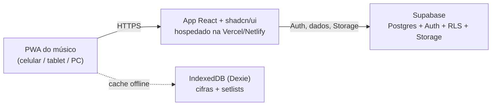

# Louve Fácil — Documento de Arquitetura

> PWA multiplataforma para equipes de louvor compartilharem cifras e letras padronizadas.
> Documento vivo: atualize conforme as decisões evoluírem.

---

## 1. Visão

**Problema:** cifras e letras despadronizadas na equipe — cada músico e cantor tem sua própria versão, em tom diferente, espalhadas em papéis, prints e grupos de WhatsApp.

**Solução:** um único lugar onde a equipe cadastra as cifras padronizadas. Todos os membros acessam no navegador ou pelo app instalado no dispositivo (PWA), com leitura offline quando necessário.

**Diferencial:** colaborativo por equipe — a referência de mercado (DataCifra, iOS) é individual. Louve Fácil é gratuito e roda em qualquer dispositivo.

**Usuários:** músicos e cantores de equipes de louvor, iniciantes e intermediários.

---

## 2. Modelo de equipes

### Fluxo de uso

1. Membro da equipe **se cadastra** (e-mail ou Google).
2. Cria uma **equipe** (ex. "Equipe de Louvor Matutina") — quem cria vira **dono**.
3. O dono **convida membros** via link de convite (código com expiração, compartilhado pelo WhatsApp). O convidado abre, se cadastra e entra na equipe.
4. Dono/editores **cadastram as cifras padronizadas** (título, tom, temas, letra com acordes).
5. Todos os membros veem a **biblioteca e os setlists** da equipe.
6. Membros de **outras equipes não têm acesso** — nem por busca, nem por link direto.

### Papéis

| Papel | Permissões |
| --- | --- |
| Dono | tudo + gerenciar membros e convites |
| Editor | criar/editar cifras e setlists |
| Membro | apenas visualizar |

### Regras

- Isolamento entre equipes garantido por **RLS** (Row Level Security) no banco — a aplicação não decide quem vê o quê; o banco nega.
- Um usuário **pode pertencer a várias equipes** (seletor de equipe no app).
- Convites são revogáveis e expiram.

---

## 3. Escopo

### MVP

| Recurso | Incluído |
| --- | --- |
| Login (e-mail/Google) | ✓ |
| Criar equipe + convite por link | ✓ |
| Biblioteca com busca e temas | ✓ |
| Editor de cifra com preview ao vivo | ✓ |
| Visualizador com transposição e fonte ajustável | ✓ |
| Setlists (repertório, reordenar, duplicar) | ✓ |
| Modo "tocar" (navegar entre músicas do setlist) | ✓ |
| PWA instalável + leitura offline dos dados já abertos | ✓ |
| Modo claro/escuro | ✓ |

### Fora de escopo (por decisão)

- Catálogo público de cifras (estilo CifraClub) — o app é interno da equipe.

### Pós-MVP

- Rolagem automática
- Importação por link (CifraClub/TXT)
- Exportar PDF
- Gravador e áudio vinculado à música
- Anotações pessoais
- Modo telão (projeção)
- Pedal Bluetooth (experimental no navegador, via Web Bluetooth/MIDI — só Chrome/Edge)

---

## 4. Stack (100% gratuita)

| Camada | Escolha | Justificativa |
| --- | --- | --- |
| Frontend | React + TypeScript + Vite | leve e direto para PWA |
| UI | Tailwind CSS + shadcn/ui | visual bonito, acessível, componentes próprios no repo |
| Backend/DB | Supabase (Postgres + Auth + Storage) | free tier generoso, login pronto, permissões por equipe via RLS |
| Hospedagem | Vercel ou Netlify | deploy automático do GitHub |
| PWA | vite-plugin-pwa | manifest + service worker prontos |
| Offline (dados) | IndexedDB via Dexie | cache de cifras/setlists no dispositivo |
| Formato de cifra | ChordPro (`[Am]` inline) + ChordSheetJS (a avaliar) | parse e transposição prontos; padrão conhecido por músicos |

> Conferir cotas atuais dos free tiers no site de cada serviço. O uso de uma equipe cabe folgado nos planos gratuitos.

---

## 5. Arquitetura



**Princípios:**

- **Sem backend próprio:** o SPA (React) fala direto com o Supabase via SDK JS. Regra de acesso no banco (RLS), regra de negócio no cliente.
- **Transposição é render, não dado:** o texto-fonte da cifra nunca muda; a transposição é aplicada na visualização e salva como desvio (`+2`, `-1`) no item do setlist.
- **Offline-first na leitura:** o service worker mantém o app shell; cifras e setlists já abertos ficam em IndexedDB. Escrita exige conexão (aceitável no MVP).
- **Edge Functions** (se um dia precisar, ex. importação por link): pós-MVP.

---

## 6. Modelo de dados

Usuários ficam em `auth.users` (Supabase Auth). O restante no schema público:

```sql
teams (
  id         uuid primary key,
  name       text not null,
  created_by uuid references auth.users,
  created_at timestamptz default now()
)

team_members (
  id        uuid primary key,
  team_id   uuid references teams,
  user_id   uuid references auth.users,
  role      text not null check (role in ('owner','editor','member')),
  joined_at timestamptz default now(),
  unique (team_id, user_id)
)

invites (
  id         uuid primary key,
  team_id    uuid references teams,
  code       text unique not null,
  expires_at timestamptz,
  revoked    boolean default false,
  created_by uuid references auth.users
)

songs (
  id           uuid primary key,
  team_id      uuid references teams,
  title        text not null,
  artist       text,
  original_key text,              -- ex. 'G', 'Bb'
  themes       text[] default '{}',
  content      text,               -- cifra em ChordPro
  created_by   uuid references auth.users,
  created_at   timestamptz default now(),
  updated_at   timestamptz default now()
)

setlists (
  id         uuid primary key,
  team_id    uuid references teams,
  name       text not null,
  event_date date,
  created_by uuid references auth.users,
  created_at timestamptz default now()
)

setlist_items (
  id         uuid primary key,
  setlist_id uuid references setlists,
  song_id    uuid references songs,
  position   int not null,        -- ordem no repertório
  transpose  int default 0        -- desvio de tom salvo por item
)
```

### Exemplo de política RLS

```sql
-- Cifras visíveis apenas a membros da própria equipe
create policy "membros leem cifras da equipe"
on songs for select
using (
  exists (
    select 1 from team_members m
    where m.team_id = songs.team_id
      and m.user_id = auth.uid()
  )
);

-- Só dono/editor alteram (mesma estrutura, com role in ('owner','editor'))
```

Toda tabela recebe o mesmo padrão: `select` para membros; `insert/update/delete` para dono/editor; `team_members`/`teams` com regras próprias (dono gerencia).

---

## 7. Formato de cifra (ChordPro adaptado)

Acordes entre colchetes, posicionados antes da sílaba; metatags no topo.

```
{title: Exemplo de Cifra}
{key: G}

[Intro] G  D/F#  Em7  C9

[G]Cada [D/F#]palavra em seu [Em7]lugar,
[C9]acordes entre colchetes antes da sílaba.
```

- **Render:** acordes exibidos acima da letra (grade de duas linhas).
- **Transposição:** calculada na renderização, escolhendo sustenidos ou bemóis conforme a tonalidade; o texto-fonte permanece intacto.
- Biblioteca candidata: **ChordSheetJS** (parse, render, transposição). Alternativa: parser próprio — o formato é simples.

---

## 8. Telas e rotas

| Rota | Tela |
| --- | --- |
| `/login` | login e cadastro |
| `/equipes` | seletor de equipes, criar equipe |
| `/biblioteca` | lista de cifras, busca, filtros por tema |
| `/cifra/nova` | editor com preview ao vivo |
| `/cifra/:id` | visualizador (transposição, fonte, claro/escuro) |
| `/setlists` | lista de repertórios |
| `/setlist/:id` | repertório: ordenar, duplicar, compartilhar |
| `/setlist/:id/tocar` | modo tocar: navegação entre músicas com tom salvo |
| `/config` | perfil, gerenciar membros e convites |

---

## 9. Roteiro de desenvolvimento

### Fase 0 — Alicerce (½–1 dia)

- [ ] Repo no GitHub
- [ ] Vite + React + TS + Tailwind + shadcn/ui configurados
- [ ] Projeto Supabase criado + variáveis de ambiente
- [ ] Deploy automático na Vercel/Netlify
- [ ] PWA mínima instalável ("Hello World")

### Fase 1 — Núcleo (1–2 semanas de noites)

- [ ] Login e cadastro (Google + e-mail)
- [ ] Criar equipe, convite por link, entrar em equipe
- [ ] CRUD de cifras com editor + preview
- [ ] Biblioteca com busca e temas
- [ ] Visualizador com transposição e tamanho de fonte
- [ ] Modo escuro
- **Pronto quando:** dois usuários em equipes diferentes não veem os dados um do outro, e um membro convidado por link vê a biblioteca da equipe.

### Fase 2 — Repertório (≈1 semana)

- [ ] Setlists: criar, reordenar (drag), duplicar
- [ ] Transposição salva por item do setlist
- [ ] Modo "tocar" (navegar de música em música)
- **Pronto quando:** um culto inteiro cabe num setlist navegável com os tons ajustados.

### Fase 3 — PWA e offline (≈1 semana)

- [ ] Ícone, manifest, instalável
- [ ] Cache offline (app shell + cifras/setlists já abertos)
- **Pronto quando:** instalar no celular e abrir a cifra do último ensaio sem internet.

---

## 10. Riscos e notas

- **Free tiers:** conferir cotas e política de pausa por inatividade do Supabase; um acesso semanal evita pausa. Vercel/Netlify free suportam o uso de uma equipe sem problema.
- **Importação por link** (CifraClub): depende de scraping, quebra quando o site muda — ficou no pós-MVP de propósito.
- **Direitos autorais:** as cifras ficam em área privada da equipe (uso interno), sem distribuição pública.
- **PWA no iPhone:** instalação pela opção "Adicionar à Tela de Início" do Safari; sem loja de apps.
- **Pedal Bluetooth:** no navegador é experimental (Web Bluetooth/MIDI, Chrome/Edge) — pós-MVP.

---

## 11. Convenções

- Interface e textos em **PT-BR**; identificadores de código em inglês.
- Commits pequenos e descritivos; uma tarefa por vez quando o trabalho for feito com agentes de IA.
- Rodar lint e preview local antes de cada PR.
- Toda mudança de acesso passa por revisão das políticas RLS.
