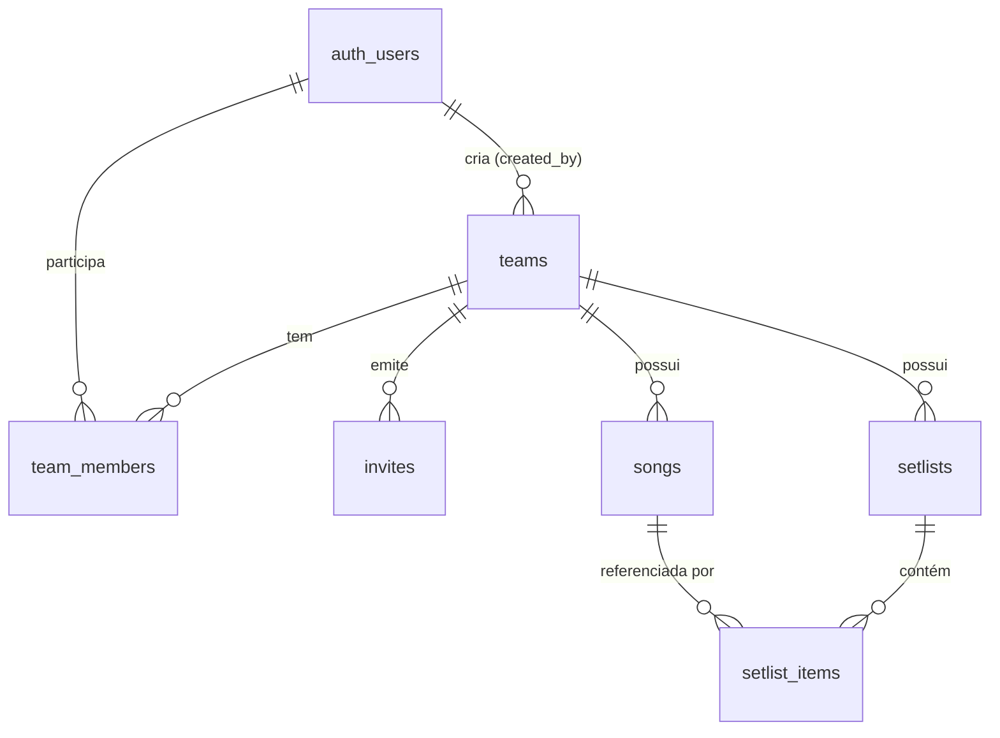

# Data Model: MVP do Louve Fácil

**Feature**: `001-louve-facil-mvp` | **Date**: 2026-11-11

Deriva de `spec.md` (Key Entities) e do schema do documento de arquitetura.
Fonte da verdade do schema: `supabase/migrations/*.sql` (contrato resumido em
[contracts/supabase-schema.md](./contracts/supabase-schema.md)).

## Visão geral

Autenticação vive em `auth.users` (gerida pelo Supabase Auth; e-mail/senha).
Todo o resto no schema `public`. Unidade de isolamento: `team_id` em todas as
tabelas de conteúdo.



## Entidades

### teams — Equipe

| Coluna | Tipo | Regras |
| --- | --- | --- |
| id | uuid pk | `gen_random_uuid()` |
| name | text not null | 1–120 caracteres |
| created_by | uuid not null → auth.users | dono da equipe |
| created_at | timestamptz | default `now()` |

Regras: criar equipe é **sempre** via RPC `create_team` (insere a equipe e o
vínculo `owner` do criador atômicos no banco — coerente com a restrição
"insert somente via RPC" da matriz RLS abaixo). Dono identificado por
`created_by` de `teams` **e** papel `owner` em `team_members` (ambos sempre
consistentes).

### team_members — Vínculo usuário ↔ equipe

| Coluna | Tipo | Regras |
| --- | --- | --- |
| id | uuid pk | |
| team_id | uuid not null → teams on delete cascade | |
| user_id | uuid not null → auth.users on delete cascade | |
| role | text not null | `owner` \| `editor` \| `member` |
| display_name | text not null | 1–80 caracteres (nome exibido à equipe; D-5) |
| joined_at | timestamptz | default `now()` |

Restrições: `unique (team_id, user_id)`; **um único `owner` por equipe**
(garantido por índice único parcial `unique (team_id) where role='owner'`).

Transições de papel: `member ↔ editor` pelo dono (RPC `update_member_role`).
Dono não é rebaixado, não remove a si mesmo nem pode ser removido (política +
RPC validam). Saída voluntária: somente para não-donos (RPC `leave_team`).

### invites — Convite

| Coluna | Tipo | Regras |
| --- | --- | --- |
| id | uuid pk | |
| team_id | uuid not null → teams on delete cascade | |
| code | text unique not null | URL-safe, gerado pelo cliente, ≥ 8 caracteres |
| expires_at | timestamptz not null | default `now() + 7 days` (dono escolhe prazo) |
| revoked | boolean not null | default `false` |
| created_by | uuid not null → auth.users | |
| created_at | timestamptz | default `now()` |

Válido ⟺ `revoked = false AND expires_at > now()`. Estado: **ativo →
revogado** (pelo dono) ou **ativo → expirado** (tempo). Consumo só via RPC
`join_team_with_code` (D-4); sem `insert/update/delete` diretos por não-donos.

### songs — Cifra

| Coluna | Tipo | Regras |
| --- | --- | --- |
| id | uuid pk | |
| team_id | uuid not null → teams on delete cascade | |
| title | text not null | 1–200 caracteres |
| artist | text null | ≤ 200 |
| original_key | text null | tom de referência; formato `A–G` + opcional `#`/`b` (ex. `G`, `Bb`) |
| themes | text[] not null | default `{}`; etiquetas livres; normalização canônica no app (trim, sem duplicatas case-insensitive) |
| content | text not null | cifra ChordPro (contrato em [contracts/chordpro-format.md](./contracts/chordpro-format.md)); ≤ 20.000 caracteres |
| created_by | uuid not null → auth.users | |
| created_at / updated_at | timestamptz | `updated_at` por trigger |

Fonte única da verdade do conteúdo (Princípio IV): `content` nunca é mutado
por transposição/visualização. Exclusão de cifra → `setlist_items` removidos
em cascata (edge case da spec: ordem dos restantes renumerada pela app).

### setlists — Repertório

| Coluna | Tipo | Regras |
| --- | --- | --- |
| id | uuid pk | |
| team_id | uuid not null → teams on delete cascade | |
| name | text not null | 1–160 |
| event_date | date null | data do evento |
| created_by | uuid not null → auth.users | |
| created_at / updated_at | timestamptz | `updated_at` por trigger |

### setlist_items — Item de repertório

| Coluna | Tipo | Regras |
| --- | --- | --- |
| id | uuid pk | |
| setlist_id | uuid not null → setlists on delete cascade | |
| song_id | uuid not null → songs on delete cascade | |
| position | int not null | ≥ 1; ordem no repertório |
| transpose | int not null | default `0`; desvio em semitons, −11..+11 |

Restrições: `unique (setlist_id, song_id)` (mesma música não repete no
setlist); `unique (setlist_id, position) deferrable initially deferred`
(reordenação atômica). Reordenação e duplicação são atômicas via RPC
(`reorder_setlist`, `duplicate_setlist`) — evita janelas de corrida entre
updates sequenciais do client.

Transposição exibida = cifra renderizada + `transpose` do item (Princípio IV).

## Cache local (Dexie / IndexedDB)

Espelho de leitura para offline (D-2): tabelas `teams`, `team_members`,
`invites`, `songs`, `setlists`, `setlist_items` com as mesmas chaves, campo
`_fetched_at` por linha para last-write-wins do servidor sobre o cache.
Escritas online-only. Logout limpa a base local inteira.

## RLS — políticas (contrato; SQL completo nas migrações)

Helpers `SECURITY DEFINER` (evitam recursão de política em `team_members`):

```sql
is_team_member(p_team_id uuid) returns boolean  -- vínculo de auth.uid() com a equipe
is_team_editor(p_team_id uuid) returns boolean  -- vínculo com role in ('owner','editor')
is_team_owner(p_team_id uuid)  returns boolean  -- vínculo com role = 'owner'
```

| Tabela | select | insert | update | delete |
| --- | --- | --- | --- | --- |
| teams | membro | **somente via RPC** (`create_team`) | dono | dono |
| team_members | membro da equipe | **somente via RPC** (`create_team` para o owner; `join_team_with_code` para convidados) | dono da equipe (via RPC `update_member_role`) | dono, e não o próprio dono (via RPC `remove_member`/`leave_team`) |
| invites | dono | dono | dono (revogar) | dono |
| songs | membro | editor/dono | editor/dono | editor/dono |
| setlists | membro | editor/dono | editor/dono | editor/dono |
| setlist_items | membro (via `setlists.team_id`) | editor/dono | editor/dono | editor/dono |

RPCs com `SECURITY DEFINER` + `search_path` fixo + validação interna:

| RPC | Assinatura | Valida |
| --- | --- | --- |
| create_team | `(p_name text, p_display_name text) returns uuid` | usuário autenticado; insere equipe + vínculo `owner` atômicos (único caminho de criação) |
| join_team_with_code | `(p_code text, p_display_name text) returns uuid` | convite válido; usuário autenticado; idempotente se já membro |
| update_member_role | `(p_member_id uuid, p_role text)` | chamador é dono; alvo não é o dono; role ∈ {editor, member} |
| remove_member | `(p_member_id uuid)` | chamador é dono; alvo não é o dono |
| leave_team | `(p_team_id uuid)` | chamador não é o dono |
| reorder_setlist | `(p_setlist_id uuid, p_ordered_item_ids uuid[])` | chamador é editor; todos os itens pertencem ao setlist |
| duplicate_setlist | `(p_setlist_id uuid, p_new_name text) returns uuid` | chamador é editor; cópia independente (itens, ordem, transposições) |

Verificação (SC-003): `quickstart.md` roteia os testes de negação cruzada com
duas equipes reais; as migrações são o artefato revisável (Princípio I).
